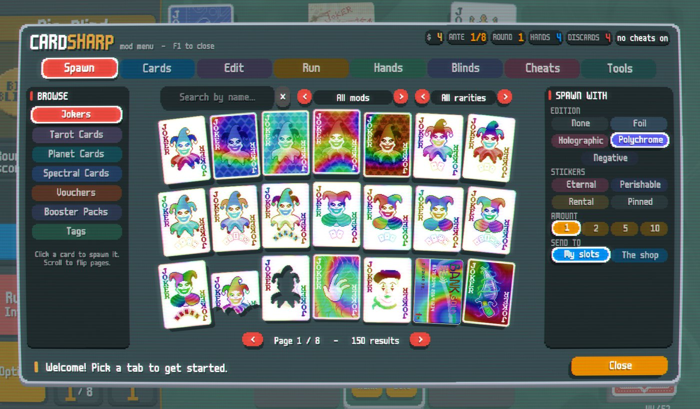
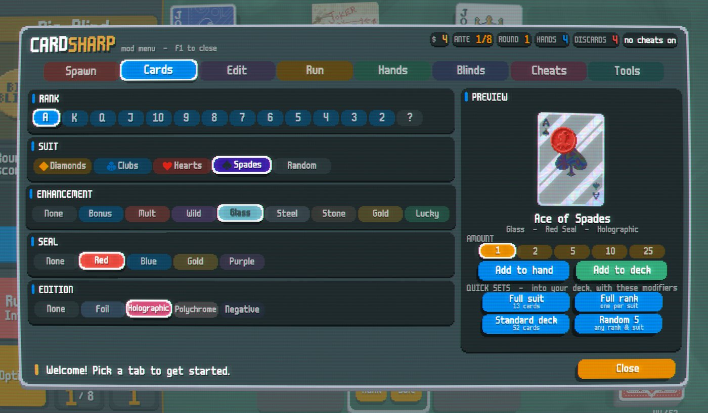
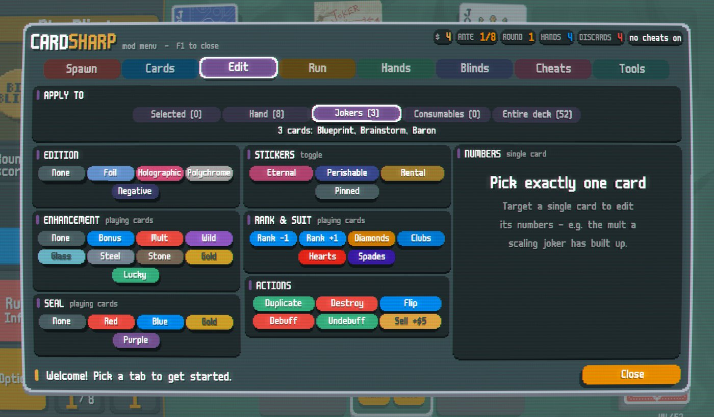
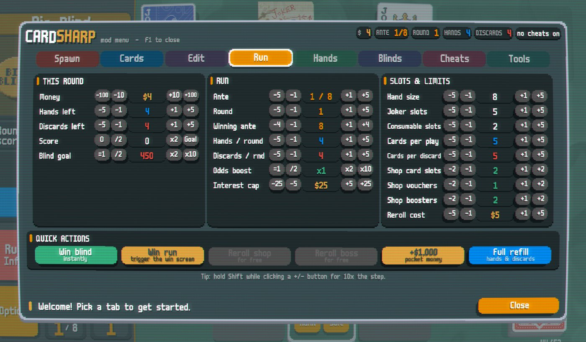
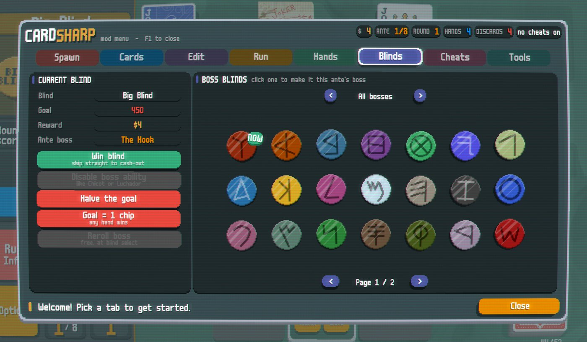

# Cardsharp

**An all-in-one mod menu for Balatro.** Spawn any card, forge custom playing cards, edit what you own, tweak every number in your run, pick boss blinds, toggle cheats, and save or load snapshots - all from one menu (**F1**).

It works with modded content: every joker, consumable type, edition, enhancement, seal, sticker, suit, rank, boss blind and tag that your other mods add shows up automatically.

## Opening it

- **F1** during a run (rebindable in *Tools > Menu hotkey*). Press it again, hit Esc, or click Close to dismiss.
- **Hover one of your cards and press F1** to jump straight to editing that card.
- **Cardsharp** button in the pause / options menu, or *Mods > Cardsharp > Config*.

## Tabs

| Tab | What it does |
| --- | --- |
| **Spawn** | Browse every joker, tarot, planet, spectral, modded consumable, voucher, booster pack and tag as real cards. Search by name, filter by mod or rarity, scroll to flip pages. Pick an edition and stickers (previewed live on the grid), an amount, and whether it goes to your slots or into the shop. Vouchers can be redeemed instantly; packs can be opened instantly. |
| **Cards** | Forge playing cards: any rank, suit, enhancement, seal and edition, with a live preview. Add to hand or deck, or add a full suit, a full rank, a standard 52-card deck, or 5 random cards. |
| **Edit** | Change cards you already own: the cards you selected, the card you hovered, your whole hand, all jokers, all consumables, or the entire deck. Set edition / enhancement / seal, toggle stickers, change rank or suit, duplicate, destroy, debuff, flip, raise sell value, and edit a single card's internal numbers (e.g. a scaling joker's mult). |
| **Run** | Money, hands, discards, score, blind goal, ante, round, winning ante, hands/discards per round, odds multiplier, interest cap, hand size, joker/consumable slots, cards per play/discard, shop slots, vouchers, boosters, reroll cost. Quick actions: win blind, win run, free shop/boss rerolls, +$1,000, refill. |
| **Hands** | Every poker hand's level, chips, mult and play count; level up/down individually or all at once; reveal secret hands. |
| **Blinds** | Current blind info, win it, disable the boss ability, halve or trivialise the goal, reroll the boss for free, or click any boss blind to make it this ante's boss. |
| **Cheats** | Persistent toggles: Infinite Hands, Infinite Discards, Money Lock, Free Shop, Free Rerolls, Never Lose, Rigged Odds, No Debuffs. Plus game speed up to 64x. |
| **Tools** | Three save-state snapshots (survive restarts), copy seed, restart with the same or a new seed, draw/recycle/shuffle the deck, repair a run, unlock or discover everything, and settings. |

Hold **Shift** while clicking a +/- button for 10x the step.

| | |
| --- | --- |
|  |  |
|  |  |

## Installation

1. Install [Lovely](https://github.com/ethangreen-dev/lovely-injector) and [Steamodded](https://github.com/Steamodded/smods) (version 26.829.0 or newer).
2. Download `Cardsharp-<version>.zip` from the Releases page and extract it into your Mods folder, so that you end up with `Mods/Cardsharp/Cardsharp.json`.
   - Windows: `%AppData%\Balatro\Mods`
   - macOS: `~/Library/Application Support/Balatro/Mods`
3. Start a run and press **F1**.

## Notes

- Cheats stay on between runs until you turn them off; the header shows how many are active.
- *Unlock everything* and *Discover everything* permanently change your profile (each asks for a second click).
- **Run repair:** when a run starts or loads, Cardsharp adds any poker hands or shop odds that mods installed after the run started expect but the save lacks (without them, those mods crash at the end of a round or on a shop restock). Only missing entries are added. It also clears stale "owned" marks that keep cards out of shops. It can be run manually from *Tools*.
- Works with Talisman / Amulet big numbers.
- Tested on Steamodded 26.829.0 with Lovely 0.10.0, both with vanilla content only and with a 60+ mod pack (including Paperback and Amulet).
- Pairs well with Foresight, a seed finder with run forecasts, save states and undo by the same author.

## Changelog

See [CHANGELOG.md](CHANGELOG.md).

## License

[MIT](LICENSE) - Copyright (c) 2026 Wickedlizerd
